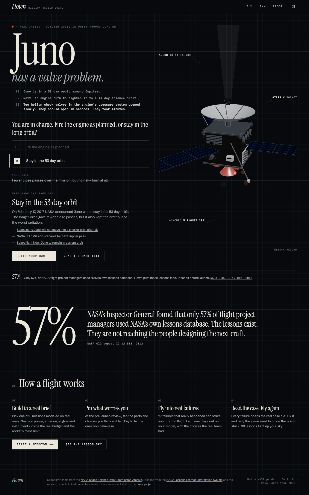

<div align="center">


# Flown

**A spacecraft design game where every way your mission can fail is a failure NASA really had.**

[Play it](https://flown-eight.vercel.app) · [Proof and sources](https://flown-eight.vercel.app/#/proof) · NASA Space Apps Challenge 2026 · Space Mission Design Game

   



</div>

## The problem

NASA writes down what went wrong on every mission. Almost nobody reads it.

In 2012 NASA's Inspector General surveyed 28 flight projects and found that **only 57% of project managers used NASA's lessons database at all**, calling it outdated and hard to use ([IG 12 012](https://www.oversight.gov/sites/default/files/oig-reports/IG-12-012.pdf)). Students learn spacecraft one subsystem at a time, so the trade offs that actually lose missions stay theory. University built satellites show the cost: in Michael Swartwout's study of university class small satellites, about 30% that reached orbit were dead on arrival and another 15% failed early ([The Space Review](https://thespacereview.com/article/3047/1)).

## What Flown does

You design a real mission inside its real budget and rocket limit. Before launch you pin what worries you. Then you fly, and the failures that strike are ones that really happened, triggered by the choices you made:

- Skip the end to end interface check and your craft can arrive far too low, like **Mars Climate Orbiter** (1999, pounds versus newtons).
- Fly an unfolding umbrella dish without a flight like deployment test and it can jam half open, like **Galileo** (1991).
- Go with three reaction wheels on a long mission and you may face **Kepler's** choice: end the mission, or balance the craft against sunlight.

When a real crisis hits, you make the call with the options your own margins allow, then see what NASA actually chose, with sources. Every failure opens a case file: what happened, the root cause, what NASA did, the lesson, and your craft next to the real one.

**The loop closes on you.** Fix the part, refly the same seed and watch the fix hold. Each lesson becomes a star in your Lesson Sky: faint until you meet it, red when it hits you, bright when you catch it before launch. Your **caught before launch rate** is the number that should rise.

## Judge fast path (2 minutes, no sign up)

1. Open [flown-eight.vercel.app](https://flown-eight.vercel.app). You are inside Juno at Jupiter in October 2016. Make the valve call and see NASA's real decision and sources.
2. Press **Build your own**, pick **Orbit Jupiter**, open the **Antenna** tab and choose the **Unfolding umbrella dish**. Set **Process: No deployment test**.
3. Go to review. Do not pin anything. Launch.
4. If the dish jams, decide the crisis, then open the **Galileo** case file. Press **Fix it and refly**, pin the antenna, pay for the fix, launch on the same seed: the fix holds.
5. Open **Sky** to see your stars and catch rate, and **Proof** for every source.

## What is real

| Part | Status |
|---|---|
| 38 failure lessons | Real, each with sources (NASA mishap reports, NTRS, NASA LLIS, mission pages, press). 10 carry NASA LLIS lesson numbers. |
| Crisis decisions and "NASA chose" | Real decisions, quoted from the lesson sources. |
| Real spacecraft facts (mass, power, rocket, launch date) | Read from NASA's NSSDCA catalog by `scripts/fetch_nssdca.py`, stored in `src/data/nssdca.json`, linked per craft. |
| Mission budgets | Approximate real mission costs, labelled "about" and "not a cap". |
| Part masses, power and costs | Simplified teaching values. The proof page compares Flown's mass rules with the real craft and publishes the error for every brief. |
| Failure chances | Game values that rise or fall with your choices. Not real probabilities. |
| Flights | Deterministic: the same design and seed always fly the same way, so a refly proves a fix. |

## How it works

```
brief ─▶ hangar (parts, instruments, processes, live budget)
      ─▶ review (pin risks, pay for fixes)
      ─▶ flight (rules from real lessons fire on your design; crises pause for your call)
      ─▶ case file (real story + sources)  ─▶ refly same seed  ─▶ Lesson Sky (catch rate)
```

- `src/engine` is pure TypeScript with tests: catalog, budget evaluation, 27 rules that map design choices to real lessons, a seeded flight simulator with crises, catch scoring, share codes and the calibration check.
- `src/data` holds the sourced lessons and the NSSDCA spacecraft facts.
- `src/ui` and `src/three` render it with React and three.js; the craft is built from your parts and every failure plays on the model.

## NASA data and resources

- NASA Space Science Data Coordinated Archive (NSSDCA) Master Catalog: spacecraft mass, power, launch vehicle and date.
- NASA Lessons Learned Information System (LLIS), NASA Technical Reports Server, NASA and JPL mission pages, NASA Office of Inspector General report IG 12 012.
- Full per lesson source list on the [proof page](https://flown-eight.vercel.app/#/proof).

Not a NASA product. No NASA logos or insignia are used.

## Use of AI tools

AI coding assistants helped write and review the code and helped gather and summarize sources for the lesson dataset; every lesson keeps its source links so each fact can be checked. No AI generated images, video or audio are used; all visuals are drawn in code.

## Run it

```bash
npm install
npm run dev      # http://localhost:5173
npx vitest run   # engine tests
npm run build
```

## License

MIT
